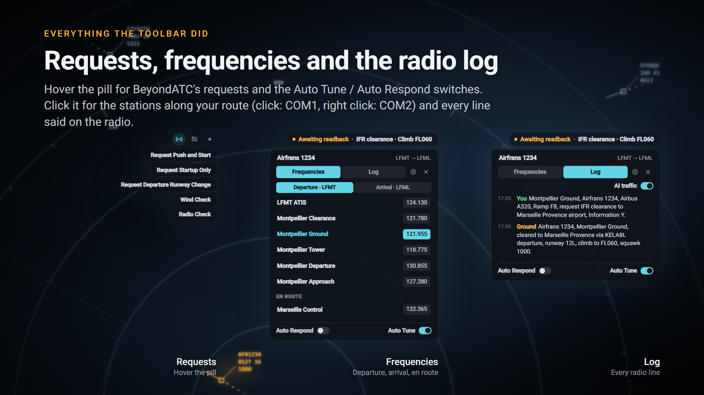
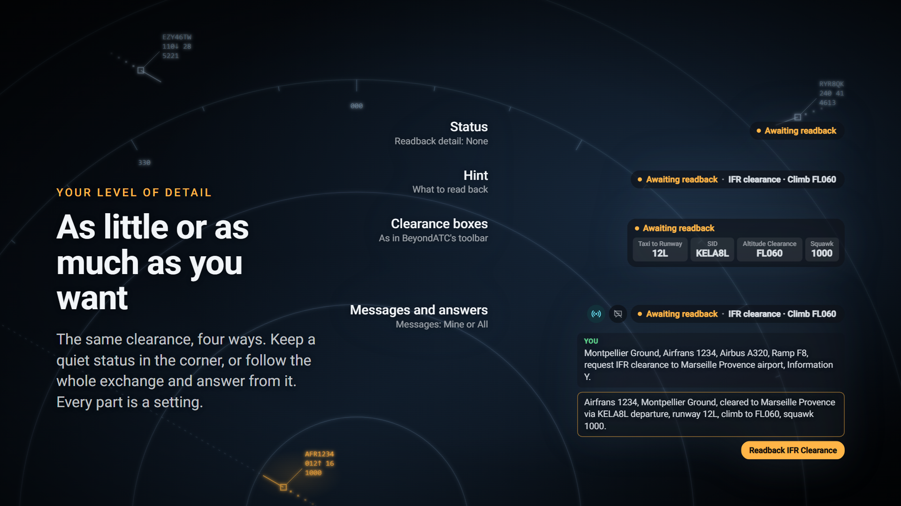
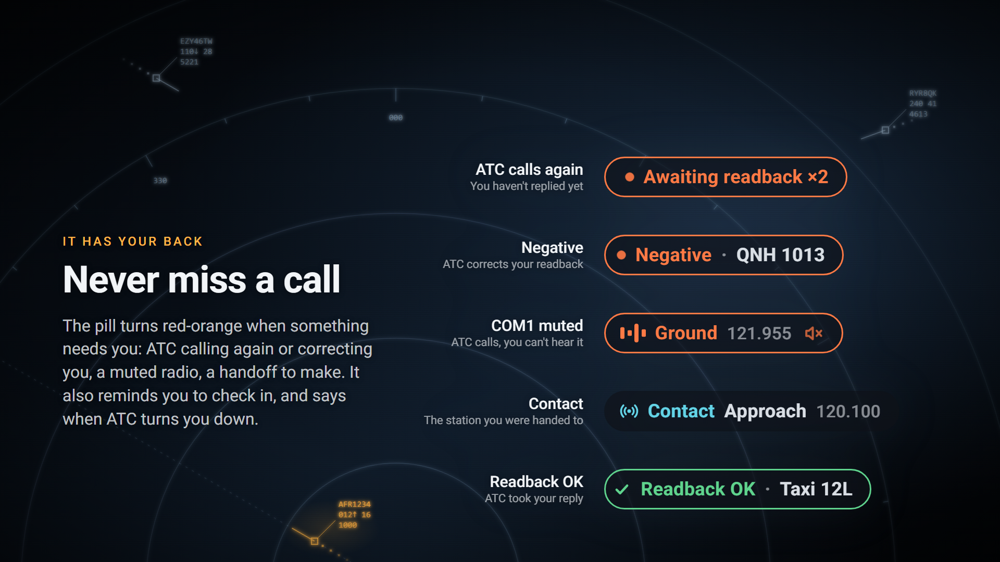

# BATC Overlay


[BeyondATC](https://www.beyondatc.net/) inside Microsoft Flight Simulator 2024, without the toolbar.

A small pill in a corner of the screen shows what's happening on the radio. Around it: ATC's messages, your answers and requests, the frequencies and the radio log. It shrinks to a dot when the radio is quiet.

## Showcase

**Replaces the toolbar.** Hover the pill for your answers and requests, click it for your frequencies (click: COM1, right click: COM2) and the radio log.



**Shows as much as you want.** From a status alone to the full exchange with answer buttons.



**Warns you.** ATC calling again, a correction, a muted COM1, a handoff to make, a station to check in with.



It also shows ATC talking, your transmissions, radio and ATIS changes, flight loading, BeyondATC's questions and errors, and lets you start a flight or load your next leg.

## Install

1. Download `paulcharp-batc-overlay-X.Y.Z.zip` from [Releases](https://github.com/paul-charp/FS24-BATC-Pill/releases).
2. Extract the `paulcharp-batc-overlay` folder into your Community folder.
   Updating from 1.x: delete the old `paul-batc-pill` folder first.
3. Start the BeyondATC app and a flight. The pill appears in the top-right corner.

Requires BeyondATC 3.x. The toolbar doesn't need to be open.

## Settings

Click the pill, then the gear in its panel. Changes apply right away, and the pill shows a sample of each change. Every setting is explained in the **[settings guide](docs/settings.md)**.

**Display**

| Setting | |
|---|---|
| Readback hints | None, Short, Hint or Boxes |
| Keep last clearance | keep your last clearance on the pill, dimmed |
| Messages | Off, Mine or All |
| Radio changes | the new station when COM1 or COM2 changes |
| Contact reminders | whom to contact after a handoff, and "Check in" |
| ATIS changes | a new ATIS letter |
| Warn when COM1 muted | red-orange pill when ATC calls on a muted COM1 |
| PTT indicator | "Transmitting" while you hold PTT |
| AI traffic | other aircraft's radio calls |
| Full station names | "Montpellier Ground" instead of "Ground" |
| Hide when BATC is off | no pill while BeyondATC isn't running |

**Position**: corner, distance from the corner, and size (60% to 250%).

The PTT indicator needs your PTT button bound a second time in the sim: see [PTT indicator](docs/settings.md#ptt-indicator).

## Compatibility

- The overlay loads through the sim's `MasterPage_InGame` UI component. Another mod that overrides it will conflict; //42 Flow and the BeyondATC toolbar don't.
- After a sim update that changes that component, install the updated release.
- CPDLC is left to the sim's own datalink pages.

## Development

The package is built from your sim install, so no Asobo files are in the repo. Set your paths in `.local/config.json`:

```json
{
  "sim_packages": "F:/XboxGames/Microsoft Flight Simulator 2024/Content/Packages",
  "community": "F:/FlightSimulator2024/LocalStorage/Community"
}
```

| Command | What it does |
|---|---|
| `python tools/build.py install` | build and link into Community (restart the sim once; later builds update in place) |
| `python tools/inspect_ui.py --push` | hot-reload `pill.js` and `pill.css` into the running sim (Devmode, inspector on `localhost:19999`) |
| `python tools/sniff_batc.py --quiet-snapshot` | log every BeyondATC socket message |
| `python tools/pill_log.py` | record a flight as the pill sees it (dev builds only) |
| `python tools/batc_timeline.py` | print the latest log as a timeline |
| `python docs/render_images.py` | render the images in `docs/images/` (headless Edge or Chrome, needs Pillow) |
| `python tools/build.py release 2.0.0` | build `dist/paulcharp-batc-overlay-2.0.0.zip` |

Logs go to `%LOCALAPPDATA%\paul-batc-pill\logs`. `tools/harness.html` previews the pill in a browser with replayed exchanges: run `python -m http.server 8765` and open `http://localhost:8765/tools/harness.html`.

To release: set `version` in `config.json` and the date in `CHANGELOG.md`, commit, build, then:

```bash
gh release create v2.0.0 dist/paulcharp-batc-overlay-2.0.0.zip --title v2.0.0 --notes-file notes.md
```

After a sim update, `build` warns if `MasterPage_InGame` changed: check the pill in flight, run `python tools/build.py lock`, and release.

CI checks the JS, Python and JSON, and runs `tools/check_pill.js`. It can't build the package (that needs a sim install).

## How it works

The overlay connects to the socket BeyondATC's toolbar uses (`ws://127.0.0.1:41716`). It reads the same messages and sends the toolbar's own commands when you click. The build adds a one-line hook to the sim's `MasterPage_InGame` component that loads `pill.js`. More detail in [AGENTS.md](AGENTS.md).

## License

[MIT](LICENSE). Not affiliated with BeyondATC or Microsoft.
