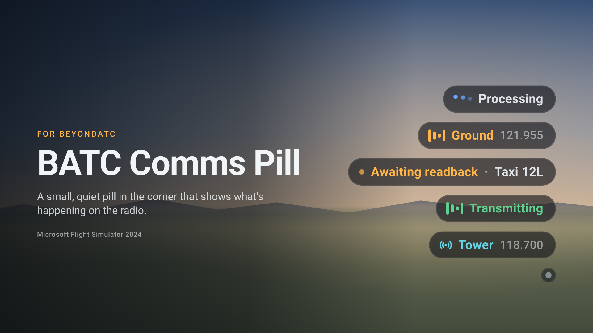
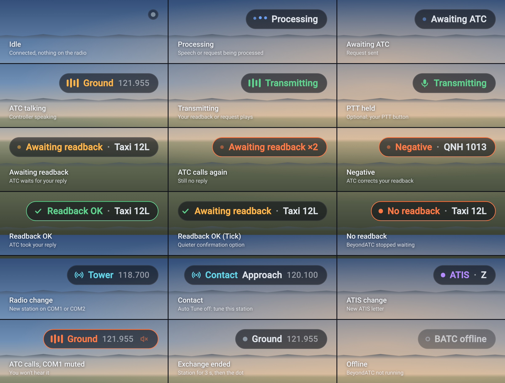
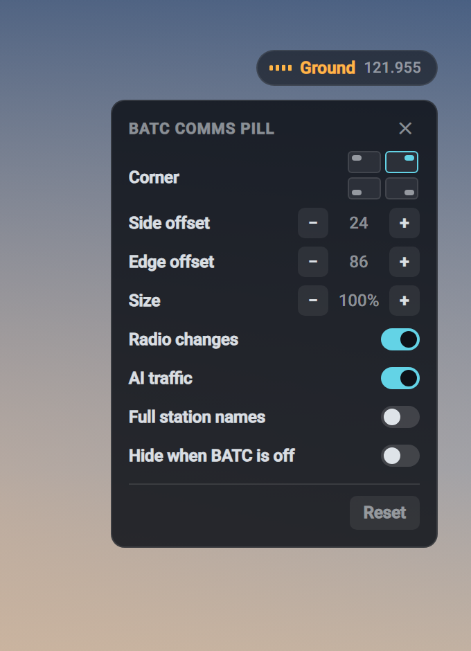

# BATC Comms Pill



A small pill in a corner of the Microsoft Flight Simulator 2024 screen that shows what [BeyondATC](https://www.beyondatc.net/) is doing on the radio. It shrinks to a dot when the radio is quiet, so you can keep the BeyondATC toolbar closed.



- **Queued / Processing / Awaiting ATC** (blue): your request is on its way.
- **ATC talking** (amber): the controller is speaking, with the station and frequency.
- **Transmitting** (green): your readback or request is being played (sound-wave icon), or you're holding PTT (mic icon, optional, see below).
- **Awaiting readback / Awaiting response** (amber, pulsing): ATC waits for your readback, acknowledgement or answer (the toolbar offers "Say Again"), with a short hint ("IFR clearance · Climb FL060", "Taxi 30R", the answers to a question: "Runway 12L / Runway 12R"), or the toolbar's clearance boxes (runway, SID, altitude, squawk). If ATC calls you again before you reply, the pill turns red-orange ("Awaiting response ×2"). If ATC answers your readback with a correction ("Negative, QNH 1013"), the pill turns red-orange with "Negative" and the correction. When ATC takes your reply, the pill turns green for 1.5 s ("Readback OK"); with **Keep last clearance** on, its hint then stays on the pill, dimmed, until the next instruction, a new station on COM1, or its ✕ (hover the pill: the clipboard icon turns into ✕). If BeyondATC stops waiting without a reply (it drops taxi and acknowledge replies after about 18 s), "No readback" shows for 5 s.
- **Radio change** (cyan): the new station when COM1 or COM2 changes.
- **Contact** (cyan): with BeyondATC's Auto Tune off, after "contact Marseille Approach on 120.100", until COM1 is on it.
- **ATIS** (purple): a new ATIS letter ("ATIS · Z"), for 6 s; and "ATIS" while COM1 plays an ATIS.
- **Exchange ended**: the station stays for 3 s, then the pill shrinks back to the dot.
- **Offline**: BeyondATC isn't running (can be hidden).

A muted COM1 adds a speaker icon; ATC calling you while it's muted turns the pill red-orange. AI traffic talking shows a neutral "Traffic" pill.

## Install

1. Download `paul-batc-pill-X.Y.Z.zip` from [Releases](https://github.com/paul-charp/FS24-BATC-Pill/releases).
2. Extract the `paul-batc-pill` folder into your Community folder.
3. Start the BeyondATC desktop app and a flight. The pill appears in the top-right corner.

Requires BeyondATC 3.x. The BeyondATC toolbar panel doesn't need to be open.

## Settings

Click the pill in flight to open its settings card (two tabs: Display and Position). Changes apply immediately. While the card is open, the pill shows a sample so you can see its size and position; after a change, the sample shows what that setting does (a radio change, a readback hint, the traffic pill, ...).



Hovering the pill shows two buttons under it: BeyondATC's **Auto Respond** (speech bubble) and **Auto Tune** (radio waves). Lit means on, dimmed and struck through means off; a click flips it, as the toolbar's own switches do.

**Display**

| Setting | |
|---|---|
| Readback hints | show when ATC waits for your readback, acknowledgement or answer |
| None / Short / Hint / Boxes | how much of it: status only, the clearance boxes' values ("30R · T1 · T1"), a short hint ("Taxi via T1 · Hold short 12L") or the toolbar's clearance boxes |
| Keep last clearance | after ATC takes your reply, keep its hint on the pill (dimmed) instead of shrinking to the dot |
| Radio changes | show the new station when COM1 or COM2 changes |
| Contact reminders | with Auto Tune off, show whom to contact until COM1 is on it |
| ATIS changes | show a new ATIS letter |
| Warn when COM1 muted | red-orange pill when ATC calls you while COM1 is muted |
| PTT indicator | show "Transmitting" while your PTT button is held (see below) |
| AI traffic | show the "Traffic" pill while AI traffic talks |
| Full station names | "Montpellier Ground" instead of "Ground" |
| Hide when BATC is off | no pill at all while BeyondATC isn't running |

**Position**

| Setting | |
|---|---|
| Corner | any of the four screen corners |
| Side offset / Edge offset | distance from the corner, in 1080p pixels (scales with resolution) |
| Size | 60% to 250% |

Settings are kept in the sim's UI storage.

### PTT indicator (optional, experimental)

BeyondATC reads your PTT button itself and doesn't tell other add-ons when it's held. To let the pill show it, bind the same button a second time in the sim: **Controls > Communications > TOGGLE SPEAKER**. Keep BeyondATC's PTT binding as it is. Then turn on **PTT indicator** in the pill's settings. The pill shows "Transmitting" once the button has been held for a quarter of a second, and goes back about a tenth of a second after you let go.

## Compatibility

- The package overrides one stock UI component, `MasterPage_InGame` (the in-flight root of the sim's UI), to load its script. Another mod that overrides the same component will conflict with it; //42 Flow and the BeyondATC toolbar don't.
- After a sim update that changes that component, use an updated release.
- BeyondATC doesn't share your PTT state; the optional PTT indicator reads a second sim binding of the same button instead (see above).
- CPDLC messages are left to the sim's own datalink pages: the pill stays silent for them.

## Development

The package is built from your local sim install (the stock component is copied and patched at build time), so no Asobo files are stored in the repo. Set your paths in `.local/config.json`:

```json
{
  "sim_packages": "F:/XboxGames/Microsoft Flight Simulator 2024/Content/Packages",
  "community": "F:/FlightSimulator2024/LocalStorage/Community"
}
```

`sim_packages` is the sim's own `Content/Packages` folder (the one holding `fs-base-ui`).

```bash
python tools/build.py install
```

Builds `build/paul-batc-pill` and junctions it into Community. Restart the sim once; after that, rebuilds are enough.

```bash
python tools/inspect_ui.py --push
```

Hot-reloads `pill.css` + `pill.js` into the running sim (Devmode on, inspector on `localhost:19999`). Fake any message with `python tools/inspect_ui.py "batcPill.feed('CommsState: {\"mode\":\"awaiting\",\"text\":\"\"}')"`, or change settings with `batcPill.set({corner: 'top-left'})`.

```bash
python tools/sniff_batc.py --quiet-snapshot
```

Logs every BeyondATC socket message with timestamps to `logs/`. Use it when BeyondATC changes its protocol.

`tools/harness.html` previews the pill in a desktop browser against the live socket, with replay buttons for captured exchanges (wind check, voice request, IFR clearance and readback, runway question) and a "Hold PTT" button: run `python -m http.server 8765` in the repo root and open `http://localhost:8765/tools/harness.html`.

```bash
python tools/batc_timeline.py
```

Prints the latest sniff log as a timeline, with the toolbar's reply menu (`Actions`) and clearance boxes (`InfoBoxes`) as +/- changes.

```bash
python docs/render_images.py
```

Renders the images in `docs/images/` with headless Edge, or Chrome/Chromium when Edge isn't installed (needs Pillow).

### Release

```bash
python tools/build.py release 1.1.0
```

Builds and zips the package as `dist/paul-batc-pill-1.1.0.zip`. Set `version` in `config.json` and the date in `CHANGELOG.md`, commit, then publish with that version's changelog section as the notes:

```bash
gh release create v1.1.0 dist/paul-batc-pill-1.1.0.zip --title v1.1.0 --notes-file notes.md
```

CI (`.github/workflows/check.yml`) checks the JS, Python and JSON on every push, and runs `tools/check_pill.js` (the pill's text patterns on real BeyondATC lines, and their speed on hostile input). It can't build the package, which needs a sim install.

### After each sim update

`build` warns when the stock `MasterPage_InGame` changed. Check that the pill still appears in flight, run `python tools/build.py lock`, and release a new version.

## How it works

- The BeyondATC desktop app serves its in-sim toolbar over `ws://127.0.0.1:41716`, in lines like `Type: payload`. `CommsState: {"mode","text"}` carries the state (`ready`, `queued`, `processing`, `request`, `awaiting`, `speaking`, `traffic`). The `ATC:` / `Player:` / `Traffic:` line before `speaking` says whose voice it is. `Facility:` (COM1) and `Com2:` changes trigger the radio-change pill. The pill only reads, except for the hover buttons: they send the toolbar's own `set_autotune: true|false` / `set_autorespond: true|false`, and BeyondATC answers every client with `AutoTune:` / `AutoRespond:`.
- Readback hints come from the toolbar's own reply menu (`Actions`): while ATC waits for you it offers "Say Again" next to the replies ("Readback Taxi Instruction", "Acknowledge Takeoff Clearance", "Runway 12L"). The clearance boxes (`InfoBoxes`) give Short and Boxes; the hint text is read from ATC's words.
- The PTT indicator asks the sim to report the `TOGGLE_SPEAKER` key event to the pill's view (the way the sim's own instruments listen to key events). A held button repeats it; the pill shows "Transmitting" while the repeats keep coming.
- `injections.json`: the build appends a hidden `` to the stock `MasterPage_InGame` cooked component, which loads `pill.js` once (the same hook //42 Flow uses). `MasterPage_InGame` only mounts in flight; the pill also hides when BeyondATC reports `LoadState.stage` `menu`.
- Clicks in flight: the sim only routes a click to the element directly under the cursor, if it has `data-input-group` and `pointer-events` isn't `none`. The pill's children ignore pointer events; every element of the settings card carries the attribute while it's open.
- `src/html_ui/paul-batc-pill/pill.js`: socket client, state machine, transitions, settings card, defaults in `CONFIG`. `pill.css`: the look; `--u` is one screen pixel at 1080p, times the size setting.

## License

[MIT](LICENSE). Not affiliated with BeyondATC or Microsoft.
